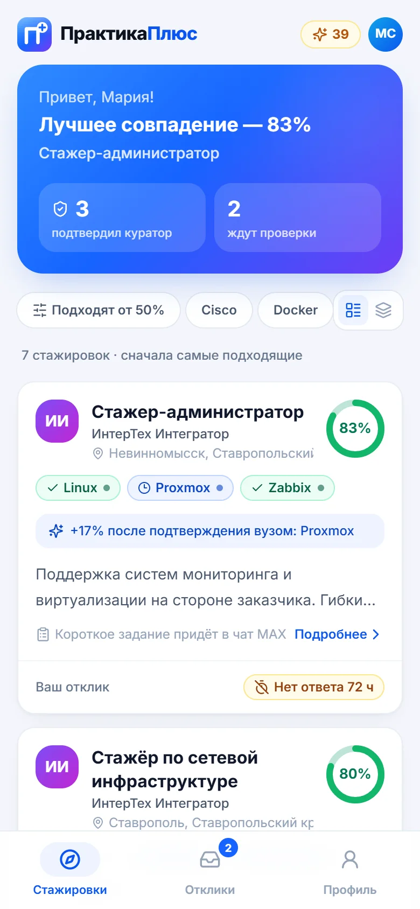
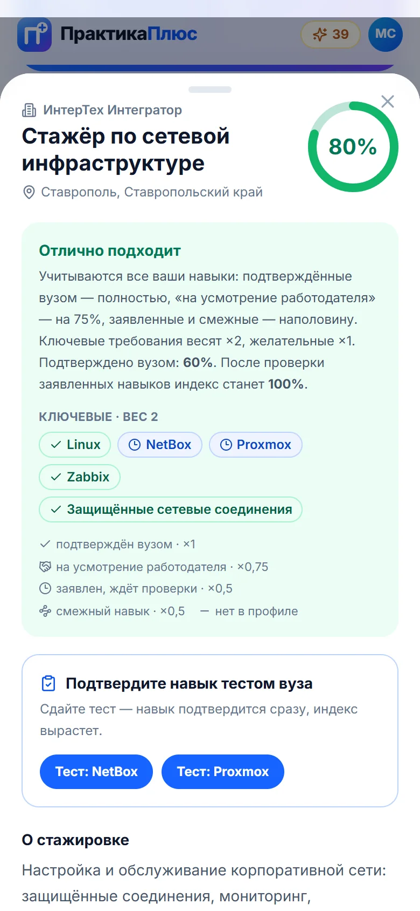
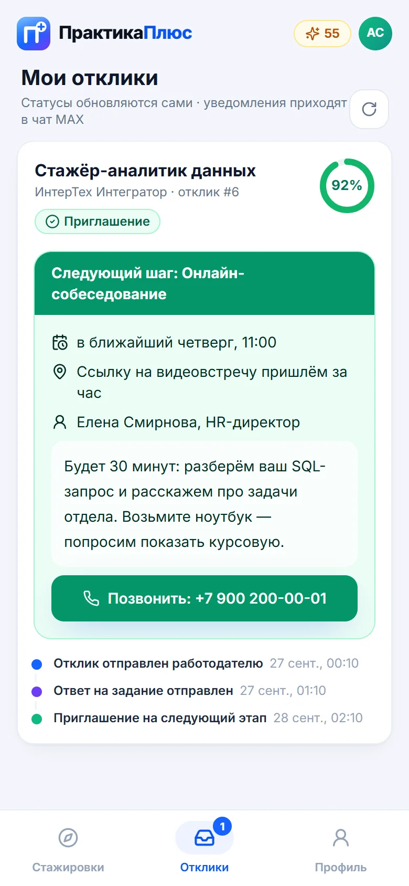
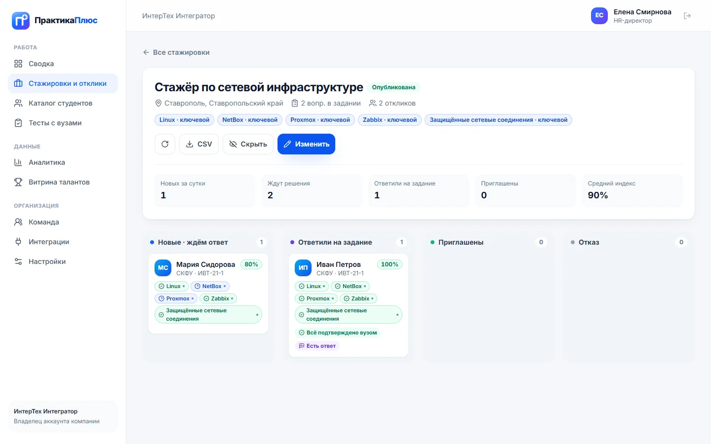

# ПрактикаПлюс — стажировки по навыкам, подтверждённым вузом

Чат-бот и мини-приложение в MAX + веб-кабинет для вузов и работодателей. Трек «Образовательные решения», хакатон MAX.

| | |
|---|---|
| Бот и мини-приложение в MAX | https://max.ru/t417_hakaton_max_bot?startapp=app (бот `t417_hakaton_max_bot`) |
| Мини-приложение (HTTPS-источник) | https://bot.praktikaplus.max.it-integrators.ru |
| Кабинет вуза и работодателя | https://lk.praktikaplus.max.it-integrators.ru |
| Сайт и правовые документы | https://praktikaplus.max.it-integrators.ru |
| API (OpenAPI 3.1: [`docs/openapi.yaml`](docs/openapi.yaml)) | https://api.praktikaplus.max.it-integrators.ru |
| Контракт проверок API | [`DATA-API.yaml`](DATA-API.yaml), тестовые данные — [`docs/test-data.json`](docs/test-data.json) |

<p>



</p>
<p>

</p>

Все скриншоты — в [`docs/screenshots`](docs/screenshots).

## 1. Назначение

Студенту технического вуза нужна производственная практика или первая стажировка, работодателю — стажёр с проверенными навыками, вузу — прозрачный процесс. Сегодня между ними резюме «со слов» и отклики, на которые никто не отвечает (57% соискателей сталкивались с игнорированием отклика — ВЦИОМ, 06.2026).

ПрактикаПлюс решает это одной механикой: **вуз проверяет навыки студента** (подтвердить / «на усмотрение работодателя» / отклонить, либо автоматически — через тест вуза), сервис считает **честный индекс соответствия** каждой стажировке с учётом степени доверия к навыку, а отклик, тестовое задание, решение компании и следующий шаг проходят **в мессенджере MAX**. Если компания молчит 72 часа, заявка снимается автоматически, а бот предлагает студенту похожие стажировки.

Приоритетный сегмент: студенты 2–4 курсов технических вузов (ИТ, связь, сети), которым нужна практика по учебному плану в своём регионе.

## 2. Основной пользовательский сценарий

1. **Вуз приглашает группу.** Администратор вуза регистрирует организацию и приглашает кураторов. Куратор создаёт группу — у неё своя ссылка `max.ru/<бот>?startapp=g_<код>` и QR-код (PNG и печатная версия).
2. **Студент регистрируется** по ссылке группы: вуз, группа, регион и город заполнены вузом и **закреплены**; студент указывает ФИО, телефон (в один тап через MAX Bridge `requestContact`), навыки и даёт согласия. Самостоятельная регистрация без приглашения тоже доступна — регион и город выбираются строго из справочника.
3. **Куратор проверяет навыки пакетно**: по каждому навыку — «Подтвердить» (с основанием: курсовой, хакатон…), «На усмотрение работодателя» или «Отклонить», затем одно «Сохранить» → студент получает **одно сводное сообщение** в MAX, без спама. Сданный тест вуза подтверждает навык автоматически.
4. **Студент видит ленту**, отсортированную по индексу: кольцо индекса, статусы навыков (подтверждён — зелёный, на усмотрение — фиолетовый, заявлен — синий, смежный, не хватает) и «+N% после проверки». Отклик — в один тап или свайпом.
5. **Вопросы тестового задания приходят в чат MAX** одним сообщением (их может быть несколько). Студент отвечает обычным сообщением (если заданий без ответа несколько — `#<номер отклика> ответ`) или в мини-приложении, где у каждого вопроса своё поле.
6. **Работодатель** (владелец аккаунта — HR-директор, приглашает рекрутеров) открывает **стажировку → её воронку**: новые, ответили на задание, приглашены, отказ. В карточке кандидата — телефон, индекс с долей «подтверждено вузом», ответы по каждому вопросу, история.
7. **Приглашение со следующим шагом**: формат (созвон / онлайн / офис / выход на стажировку), когда, где или ссылка, контактное лицо и телефон, сообщение по шаблону. Отказ — с шаблонами причин. **Любое решение уходит студенту через 90 секунд** — до этого его можно отменить, студент ничего не увидит.
8. **Анти-игнор:** через 48 ч отклик подсвечивается как просроченный, через 72 ч получает статус «Без ответа 72 ч», студенту приходят альтернативы.
9. **Визитка студента:** публичная страница с подтверждёнными навыками, основаниями, сертификатами и пройденными тестами — ссылкой в резюме или письме.
10. **Сброс для повторной проверки:** «Профиль → Сбросить профиль» или `/reset` в чате (с подтверждением кнопками).

## 3. Состав и архитектура

```
 Студент в MAX ──► Бот t417_hakaton_max_bot ──webhook──┐
      │                                                │
      └─► Мини-приложение (React, MAX Bridge) ──HTTPS──┤
                                                        ▼
 Вуз / компания ─► Веб-кабинет (React) ──HTTPS──► FastAPI backend ──► PostgreSQL 15
                                                   │  ├─ match_score.py — индекс соответствия
 Посетитель ──► Лендинг + правовые документы       │  ├─ outbox — отложенные решения (окно отмены 90 с)
                                                   │  ├─ scheduled_jobs.py — SLA 72 ч, «пассивные»
                                                   │  ├─ integrations/ — коннекторы ATS, площадок, ЭИОС, 1С
                                                   │  └─ max_client.py ──► MAX Bot API (platform-api2.max.ru)
```

| Компонент | Каталог | Технологии | Роль |
|---|---|---|---|
| Backend API + вебхук бота | `backend/` | Python 3.11, FastAPI, SQLAlchemy 2, PostgreSQL 15 | REST API, логика бота, индекс, очередь сообщений, фоновые задачи |
| Мини-приложение MAX | `frontend-pwa/` | React 18, TypeScript, Vite, Tailwind, MAX Bridge | Онбординг, лента, отклики, тесты, профиль и визитка студента |
| Кабинет вуза и работодателя | `frontend-lk/` | React 18, TypeScript, Vite, Tailwind | Стажировки и воронки, группы, проверка навыков, тесты, команда, интеграции, аналитика |
| Лендинг | `landing/` | React 18, TypeScript, Vite, Tailwind | Описание сервиса, интерактивный пример индекса, правовые документы |

Структура backend: `routers/` — HTTP-слой по доменам (`auth`, `profile`, `team`, `groups`, `vacancies`, `applications`, `students`, `skill_tests`, `integrations`, `analytics`, `webhook`), `services.py` — общая доменная логика (область видимости данных организации, пакетная сериализация без N+1, очередь сообщений), `match_score.py` + `skills_catalog.py` — алгоритм индекса, `geo.py` + `data/geo.json` — справочник регионов и городов, `seed.py` — демо-данные, `tests/` — 32 автотеста (pytest).

### Индекс соответствия

```
индекс = Σ вес(требование) × зачёт(требование) / Σ вес(требование) × 100%
вес:   2 — ключевой навык вакансии, 1 — желательный
зачёт: 1    — навык подтверждён вузом (куратором или сданным тестом)
       0,75 — «на усмотрение работодателя» (вуз не может подтвердить академически, но и не отрицает)
       0,5  — навык заявлен студентом и ещё не проверен
       0,5  — подтверждён смежный навык той же группы (FreeBSD для Linux); 0,25 — смежный заявлен
       0    — навык отсутствует или отклонён вузом
подтверждено вузом = тот же расчёт только по подтверждённым навыкам
потенциал          = расчёт, если вуз подтвердит всё заявленное
```

Пример: «Стажёр по сетевой инфраструктуре» (5 ключевых навыков). У Марии Сидоровой (`demo-student-2`) три навыка подтверждены вузом, NetBox и Proxmox заявлены: (3 × 1 + 2 × 0,5) / 5 = **80%**, из них **подтверждено вузом 60%**; работодатель видит обе цифры и цвет каждого навыка. Названия навыков нормализуются (регистр, «ё», синонимы: `postgres` → PostgreSQL). API возвращает разбивку по каждому требованию (`match.items[].status`: `verified | employer | claimed | related | missing`). Формула покрыта тестами `backend/tests/test_match_score.py`.

### Организации и роли

- **Компания:** владелец аккаунта (HR-директор) регистрирует организацию и приглашает рекрутеров по ссылке (`/invite/<токен>`, 7 дней). Все сотрудники работают с общими стажировками и откликами; владелец может отключить сотрудника — созданные им данные остаются у компании.
- **Вуз:** администратор регистрирует вуз и приглашает кураторов; группы закрепляются за кураторами, аналитика общая. Администратор решает, открыть ли каталог студентов работодателям.

### Интеграции (заложены в архитектуру)

Раздел «Интеграции» кабинета и модуль `backend/app/integrations/` описывают коннекторы к системам с публичным API: **Хантфлоу** и **Поток** (ATS — выгрузка приглашённых кандидатов), **hh.ru** и **SuperJob** (публикация стажировок), **Работа России** (trudvsem.ru — открытые данные вакансий), **Moodle** (`core_competency` — компетенции и оценки из ЭИОС вуза), **1С:Университет ПРОФ** (OData — контингент студентов и группы). Организация сохраняет подключение (секреты проверяются на наличие и не хранятся — только маска), для каждого коннектора описаны эндпоинты и соответствие полей; обмен данными включается на пилоте с конкретной организацией.

### Возможности MAX, которые используются

- **Бот:** приветствие с кнопкой запуска мини-приложения, `/status`, `/help`, `/reset` с подтверждением callback-кнопками (`message_callback` → `POST /answers`), приём ответов на вопросы тестового задания текстом, сводные уведомления о проверке навыков, решения работодателя со следующим шагом, новые подходящие стажировки, автоэскалация. **Бот отвечает только зарегистрированным студентам и перешедшим по действующей ссылке группы**; незнакомому пользователю — одно короткое сообщение не чаще раза в 10 минут.
- **Deep links `startapp`:** `app` — лента, `apps` — отклики, `vac_<id>` — стажировка, `g_<код>` — приглашение группы.
- **MAX Bridge:** проверка подписи `initData` (HMAC-SHA256) на backend, **фото профиля MAX** как аватар, `shareMaxContent` (поделиться стажировкой, сертификатом или визиткой), `requestContact` (телефон в один тап), `BackButton`, `HapticFeedback`, `openMaxLink`, `enableClosingConfirmation` (защита черновика ответа).

## 4. Запуск всех компонентов одной командой

```bash
docker compose up --build
```

`.env` для локального запуска не обязателен: значения по умолчанию в `compose.yaml` поднимают стенд с демо-данными и браузерной песочницей. Чтобы переопределить параметры: `cp .env.example .env`.

Сборка — multi-stage (Node 20 собирает фронтенды → nginx; Python 3.11-slim для API), на чистом кеше занимает 2–4 минуты.

## 5. Необходимые параметры окружения

- Docker 24+ и Docker Compose v2; свободные порты 8001–8004.
- Для работы **в самом MAX** (не требуется для локальной проверки): токен бота `MAX_BOT_TOKEN`, публичный HTTPS-адрес API для вебхука, HTTPS-адрес мини-приложения, подключённый к боту в кабинете MAX для партнёров.

## 6. Переменные окружения

| Переменная | Назначение | По умолчанию (локально) |
|---|---|---|
| `ENV` | `prod` — проверка обязательных секретов при старте (`JWT_SECRET` ≥ 32 символов, `MAX_BOT_TOKEN`) | `dev` |
| `SANDBOX_LOGIN` | вход студента в браузере без MAX под тестовым id `dev-…` / `demo-…` (числовые id MAX так войти не могут) | `true` |
| `ENABLE_DEMO_DATA` | идемпотентно создаёт демо-вузы, компании, группы, студентов, стажировки и тесты (только строки `demo-*`) | `true` |
| `POSTGRES_DB` / `POSTGRES_USER` / `POSTGRES_PASSWORD` | параметры PostgreSQL (БД наружу не публикуется) | `praktikaplus` |
| `JWT_SECRET` | подпись токенов сервиса | `dev-insecure-secret-change-me` |
| `MAX_BOT_TOKEN` | токен бота MAX; пусто → режим мока: сообщения бота пишутся в лог | пусто |
| `MAX_WEBHOOK_SECRET` | секрет вебхука (заголовок `X-Max-Bot-Api-Secret`); если задан, прочие запросы отклоняются | пусто |
| `MAX_API_BASE_URL` | адрес Bot API MAX | `https://platform-api2.max.ru` |
| `MAX_BOT_USERNAME` | ник бота для deep links и ссылок групп | `t417_hakaton_max_bot` |
| `MAX_MINIAPP_URL`, `LK_PUBLIC_URL`, `APP_BASE_URL` | публичные адреса мини-приложения, кабинета (сертификаты, визитки, приглашения) и API | `http://localhost:8003` / `8002` / `8001` |
| `API_PUBLIC_URL`, `LEGAL_BASE_URL`, `BOT_PUBLIC_URL`, `MAX_BOT_LINK_BASE` | адреса, зашиваемые в сборку фронтендов | локальные адреса / `https://max.ru/t417_hakaton_max_bot…` |
| `CORS_ORIGINS` | разрешённые источники (через запятую) | `http://localhost:8002,8003,8004` |
| `MATCH_THRESHOLD` | порог индекса для проактивного уведомления о стажировке, % | `60` |
| `DECISION_GRACE_SECONDS` | окно отмены решения работодателя до отправки студенту, с | `90` |
| `LEGAL_OPERATOR_*`, `LEGAL_EFFECTIVE_DATE` | реквизиты оператора для правовых документов | пусто → демонстрационные реквизиты хакатона с пометкой |

## 7. Порты

| Порт | Сервис |
|---|---|
| 8001 | API (FastAPI, внутри контейнера 8000); Swagger — `/docs` |
| 8002 | кабинет вуза и работодателя (+ публичные `/certificate/…`, `/p/<токен>`, `/invite/<токен>`) |
| 8003 | мини-приложение студента |
| 8004 | лендинг и правовые документы |
| — | PostgreSQL доступен только внутри docker-сети |

## 8. Зависимости

- Backend: [`backend/requirements.txt`](backend/requirements.txt) (версии зафиксированы), для тестов — [`backend/requirements-dev.txt`](backend/requirements-dev.txt).
- Фронтенды: `package.json` + `package-lock.json` в `frontend-pwa/`, `frontend-lk/`, `landing/` (сборка через `npm ci`).
- Шрифт Inter подключён пакетом `@fontsource-variable/inter`, QR-коды — `qrcode.react`; внешние CDN не используются (кроме официального скрипта MAX Bridge `st.max.ru`).
- Справочник регионов и городов — `backend/app/data/geo.json` (85 субъектов, 1 106 городов), построен по открытому набору [hflabs/city](https://github.com/hflabs/city), лицензия CC BY-SA 4.0.

## 9. Внешние сервисы и интеграции

| Сервис | Назначение | Что нужно для проверки |
|---|---|---|
| MAX Bot API (`platform-api2.max.ru`) | отправка сообщений, callback-ответы, приём вебхуков | токен бота выдан организаторами; без токена backend работает в режиме мока |
| MAX Bridge (`st.max.ru/js/max-web-app.js`) | данные запуска и фото профиля, шаринг, контакт, «Назад», хаптика | запуск мини-приложения из MAX; в браузере функции деградируют без ошибок |
| Сертификаты Минцифры | TLS-цепочка `*.max.ru` для httpx | вложены в образ (`backend/certs`) |
| ATS, площадки вакансий, ЭИОС, 1С | коннекторы описаны в `backend/app/integrations/` | настройки подключения сохраняются в кабинете; обмен данными — на пилоте |

## 10. Работа с данными

- PostgreSQL 15 в volume `praktikaplus-db-data`. Схема создаётся при старте; новые колонки добавляются аддитивной идемпотентной миграцией без удаления данных (существующие подтверждённые навыки переносятся в статус `verified`).
- Сущности: организации (владелец + сотрудники, приглашения), группы вуза с кодом приглашения, навыки студентов со **статусом проверки и комментарием вуза**, стажировки с ключевыми/желательными требованиями и **списком вопросов**, отклики с ответами по вопросам, **историей статусов**, следующим шагом и окном отмены, очередь исходящих сообщений бота, тесты навыков и попытки, подключения интеграций, журналы уведомлений, поисковые запросы.
- Доступ к данным: сотрудники организации видят общие данные своей организации; куратор — студентов своего вуза; работодатель — телефон и ответы только откликнувшихся на его стажировки, а также профили студентов, самостоятельно открывших поиск в вузе с открытым каталогом (без телефона); студент — только свои данные. Роль и организация читаются из БД на каждый запрос, отключённый сотрудник теряет доступ сразу.
- Безопасность: подпись `initData` MAX (HMAC-SHA256, срок 1 ч), JWT 12 ч, пароли PBKDF2-SHA256 (260 000 итераций), ограничение попыток входа (10 за 5 минут), обязательное согласие на обработку ПДн (152-ФЗ) с версионированием, подписанные ссылки на сертификаты, секреты интеграций не хранятся, никаких секретов в репозитории.

## 11. Тестовые данные

При `ENABLE_DEMO_DATA=true` создаются (и дополняются, если чего-то не хватает): 2 вуза (администратор + куратор), 2 компании (HR-директор + рекрутер), 4 группы с постоянными ссылками, 6 студентов с телефонами и навыками во всех статусах, 7 стажировок с вопросами, 8 откликов в разных статусах (в т.ч. приглашение со следующим шагом), 3 теста навыков. Все данные вымышлены, id начинаются с `demo-`. Полное описание и ожидаемые значения индекса — [`docs/test-data.json`](docs/test-data.json).

| Роль | Вход | Пароль |
|---|---|---|
| Администратор вуза (СКФУ) | `curator@skfu.example` | `demo12345` |
| Куратор группы ИВТ-21-2 (СКФУ) | `curator2@skfu.example` | `demo12345` |
| Администратор вуза (КубГТУ) | `curator@kubstu.example` | `demo12345` |
| HR-директор «ИнтерТех Интегратор» | `hr@intertech.example` | `demo12345` |
| Рекрутер «ИнтерТех Интегратор» | `recruiter@intertech.example` | `demo12345` |
| Владелец «ЮгТелекомSoft» | `hr@yugtelecomsoft.example` | `demo12345` |
| Студент в браузере | `<адрес мини-приложения>/?student_id=demo-student-1` (Иван, 100%), `demo-student-2` (Мария, 80% / подтверждено 60%), `demo-student-3` (Пётр, 30% / 20%) | — |
| Регистрация по ссылке группы в браузере | `<адрес мини-приложения>/?student_id=dev-<любой>&group=skfuIVT211` | — |
| Студент в MAX | ваш аккаунт MAX: `https://max.ru/t417_hakaton_max_bot?startapp=g_skfuIVT211` | — |

Служебные команды:

```bash
docker compose exec backend python -m app.seed                 # дозаполнить демо-данные
docker compose exec backend python -m app.seed --refresh-demo  # вернуть демо-отклики и навыки в исходные статусы
docker compose exec backend python -m app.seed --purge-demo    # удалить только demo-* записи
docker compose exec backend python -m app.register_webhook https://<api-домен>/webhook  # регистрация вебхука (нужен MAX_WEBHOOK_SECRET)
```

## 12. Пошаговый сценарий проверки

**В MAX (основной):**
1. Откройте ссылку группы https://max.ru/t417_hakaton_max_bot?startapp=g_skfuIVT211 → «Присоединиться к группе ИВТ-21-1»: вуз, группа и город уже заполнены и закреплены. Укажите телефон (кнопка «из MAX») и отметьте, например, Linux, Zabbix, Proxmox.
2. В ленте индекс «Стажер-администратор» уже 50% (заявленные навыки засчитываются наполовину) и «+50% после проверки». Войдите в кабинет https://lk.praktikaplus.max.it-integrators.ru как `curator@skfu.example` → «Группы» → ИВТ-21-1 (там же QR-код) → «Проверить» у себя: подтвердите навыки с основанием, один — «на усмотрение работодателя» → «Сохранить». В MAX придёт одно сводное сообщение.
3. Откликнитесь на «Стажер-администратор» → вопросы придут в чат с ботом → ответьте сообщением (или в мини-приложении по каждому вопросу).
4. Войдите как `hr@intertech.example` → «Стажировки и отклики» → «Стажер-администратор»: ваша карточка в колонке «Ответили на задание», в карточке — телефон, индекс и ответы → «Пригласить» → выберите «Онлайн-собеседование», время и ссылку. Сообщение уйдёт через 90 секунд (можно нажать «Отменить»); затем в MAX придёт приглашение с кнопкой «Позвонить» в мини-приложении.
5. «Профиль → Визитка для работодателя» — включите и откройте публичную ссылку. «Сбросить профиль» или `/reset` → «Да, сбросить» — профиль вернётся к регистрации.

**Локально без MAX:** `docker compose up --build` → http://localhost:8003/?student_id=dev-test1&group=skfuIVT211 (новый студент по ссылке группы) или `?student_id=demo-student-2`, http://localhost:8002 (кабинет, демо-кнопки входа на странице), http://localhost:8004 (лендинг), http://localhost:8001/docs (Swagger). Сообщения бота видны в логе: `docker compose logs backend | grep "MAX MOCK"`. Ответ боту эмулируется вебхуком:

```bash
curl -X POST http://localhost:8001/webhook -H "Content-Type: application/json" \
  -d '{"update_type":"message_created","message":{"sender":{"user_id":"demo-student-2"},"body":{"text":"/status"}}}'
```

**Автотесты:** `cd backend && pip install -r requirements-dev.txt && pytest` — 32 теста: формула индекса со всеми статусами, сценарий «навыки → пакетная проверка → отклик → ответы → решение → окно отмены → доставка», группы и закреплённые поля, команды организаций, визитка, тесты навыков, интеграции без хранения секретов, безопасность бота, ролевые ограничения, rate limit.

## 13. Примеры ожидаемого поведения

- `GET /api/vacancies` (студент) → стажировки, отсортированные по `match.score`; у каждой — `match.score`, `match.verified_score`, `match.potential` и `match.items[]` со статусами `verified | employer | claimed | related | missing`.
- `demo-student-1 / 2 / 3` на «Стажёр по сетевой инфраструктуре» → индекс **100 / 80 / 30%**, подтверждено вузом **100 / 60 / 20%**.
- `GET /api/vacancies/{id}/applications` (компания) → воронка одной стажировки с `student_phone`, `test_questions`, `test_answers`.
- `PATCH /api/applications/{id}` `{"status":"accepted","next_step":{…}}` → студент в течение 90 с видит отклик «на рассмотрении»; `POST /api/applications/{id}/undo` в этом окне → статус возвращается, сообщение не отправляется; после окна → `409`.
- `PUT /api/students/{id}/skills` с тремя решениями → `{"changed": 3, "notified": true}`, студенту ставится **одно** сообщение.
- `PUT /api/me` c `group_code` → вуз, группа, регион и город берутся из группы; попытка изменить их позже игнорируется. Регион или город не из справочника → `422`.
- Незарегистрированный пользователь пишет боту → одно сообщение «откройте ссылку от вуза», повтор в течение 10 минут — без ответа.
- `POST /api/auth` с `{"user_id":"123456789"}` (числовой id MAX без подписи) → `401`; студент вызывает `POST /api/vacancies` → `403`; 11-я неудачная попытка входа за 5 минут → `429`.
- `POST /api/me/reset` → `{"removed_skills": N, "removed_applications": M, …}`, следующий запуск мини-приложения показывает регистрацию.

## 14. Известные ограничения

- Коннекторы к ATS, площадкам вакансий, ЭИОС и 1С описаны и сохраняют настройки подключения, но обмен данными включается на пилоте с конкретной организацией.
- Ответ на тестовое задание — только текстом; файлы из MAX не принимаются.
- HR и кураторы работают в веб-кабинете и не получают уведомления в MAX (у их аккаунтов нет MAX-идентичности); напоминание о просрочке — подсветка в кабинете.
- Демо-аккаунты общие для всех проверяющих: смена пароля демо-организаций и сброс демо-студентов (`demo-*`) заблокированы, демо-отклики не участвуют в автоэскалации. Для проверки сброса используйте свой аккаунт MAX или новый sandbox-id `dev-…`.
- `MAX_WEBHOOK_SECRET` на стенде не задан, чтобы не перерегистрировать рабочую подписку бота во время проверки; механизм проверки секрета реализован и покрыт тестом.
- Правовые документы содержат демонстрационные реквизиты вымышленной компании (сервис создан для хакатона); для коммерческого запуска задаются `LEGAL_OPERATOR_*`.

## 15. Остановка и повторный запуск

```bash
docker compose down            # остановить, данные остаются в volume
docker compose up -d           # запустить снова (демо-данные не дублируются)
docker compose up --build -d   # пересобрать после изменений кода
docker compose down -v         # остановить и удалить данные; следующий запуск создаст демо-данные заново
```
# max-hackathon-urtisi

